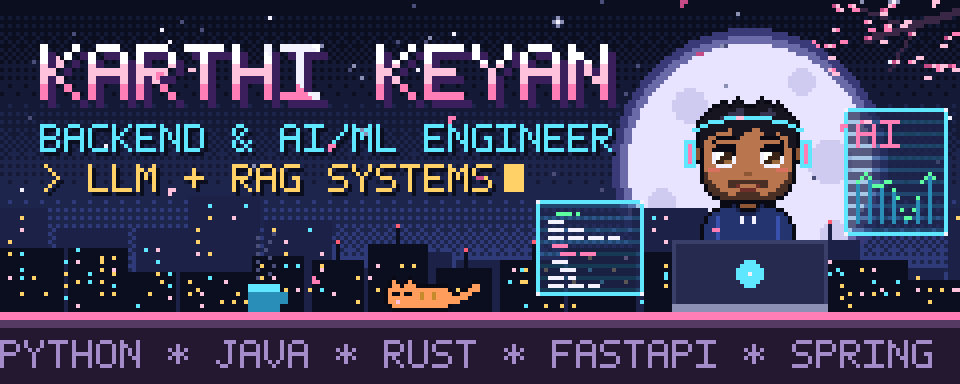
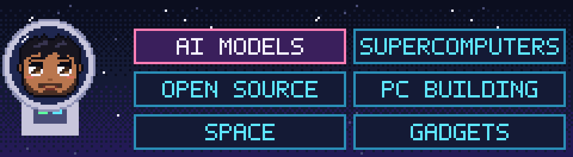
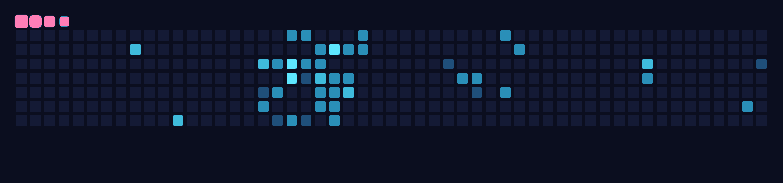

<p align="center">
  
</p>

<p align="center">
  
</p>

<p align="center">
  <a href="https://karthi-portfolio-five.vercel.app"></a>
  <a href="https://www.linkedin.com/in/karthikeyan-p-7822a4249/"></a>
  <a href="mailto:karthikeyanp.dev@gmail.com"></a>
  
</p>

I build REST APIs and microservices in **Python (FastAPI)** and **Java (Spring Boot)**, then wire **LLMs and RAG** into them. My projects lean toward distributed systems, observability and security.

```yaml
now:        Full Stack Developer @ Stackly
before:     AI Developer @ Codec Technologies
freelance:  3+ data analytics and ML client projects
focus:      backend, LLM chatbots, event-driven systems
learning:   cybersecurity, system design, DSA in Java
education:  B.Tech AI & Data Science, Anna University
based_in:   Ramanathapuram, Tamil Nadu, India
```

<h2 align="center"></h2>

<table>
  <tr>
    <td width="24%"><b>Languages</b></td>
    <td><br /><sub>Python · Java · JavaScript · TypeScript · Rust · SQL</sub></td>
  </tr>
  <tr>
    <td><b>Backend &amp; AI/ML</b></td>
    <td><br /><sub>FastAPI · Spring Boot · REST APIs · Microservices · SQLAlchemy · Pydantic · JWT/OAuth2 · LLMs · RAG · NLP · Computer Vision · PyTorch · BERT</sub></td>
  </tr>
  <tr>
    <td><b>Data &amp; Frontend</b></td>
    <td><br /><sub>Pandas · NumPy · Matplotlib · React.js · Tailwind CSS · Flutter</sub></td>
  </tr>
  <tr>
    <td><b>Cloud &amp; DevOps</b></td>
    <td><br /><sub>AWS (EC2, AMI, Marketplace) · Azure · DigitalOcean · Docker · GitHub Actions · CI/CD · Linux · Prometheus · Grafana</sub></td>
  </tr>
  <tr>
    <td><b>Data Stores &amp; Messaging</b></td>
    <td><br /><sub>PostgreSQL · Elasticsearch · MinIO · RabbitMQ · Redis · Kafka · Celery</sub></td>
  </tr>
</table>

<h2 align="center"></h2>

| The problem | How I solved it | Where |
|---|---|---|
| Jobs stuck in `CREATED` with no retry when a worker crashed | Distributed execution over Kafka with Redis coordination, exponential backoff and a dead-letter queue | [**OrbitFlow**](https://github.com/KarthiKeyanZz/orbitflow) |
| High-volume log ingestion slowed analysis and delayed root-cause alerts | Kafka and Elasticsearch pipelines with deep-learning anomaly detection | [**DevBrain**](https://github.com/KarthiKeyanZz/devbrain) |
| Stored files needed proof that nobody had tampered with them | AES encryption plus a hash chain that records every file operation and exposes tampering | [**SecureVault**](https://github.com/KarthiKeyanZz/securevault) |
| Cloud round trips added latency to high-frequency live data | Python edge decision engine with WebSockets and instant rolling metrics | [**PulseIQ**](https://github.com/KarthiKeyanZz/pulseiq) |
| Threat data is only useful if it is analyzed as it arrives | ML anomaly detection and LLM attack analysis on a live WebSocket dashboard | [**AthenaCore**](https://github.com/KarthiKeyanZz/athenacore) |
| Replayed refresh tokens and silently overwritten updates | Rotating token families with reuse detection, and optimistic concurrency via `ETag` / `If-Match` | [**SnipVault**](https://github.com/KarthiKeyanZz/snipvault) |
| Manual releases were slow and error-prone | Automated CI/CD pipelines to Azure for safe, repeatable deployments | **Stackly** |
| Chatbots need answers grounded in real documents | LLM chatbot with Retrieval-Augmented Generation for context-aware responses | **Codec Technologies** |

<h2 align="center"></h2>

<table>
  <tr>
    <td width="50%" valign="top">
      <br />
      <b>Gaming</b><br />
      <sub><b>Story:</b> RDR2, Skyrim, GTA V, Assassin's Creed (Ezio arc)<br /><b>Competitive:</b> CS:GO, PUBG, War Thunder</sub>
    </td>
    <td width="50%" valign="top">
      <br />
      <b>Reading</b><br />
      <sub>Technology and engineering books, high fantasy novels, sci-fi Japanese manga</sub>
    </td>
  </tr>
  <tr>
    <td width="50%" valign="top">
      <br />
      <b>PC building</b><br />
      <sub>Mid-range and gaming rigs configured from scratch, cable management, performance tuning</sub>
    </td>
    <td width="50%" valign="top">
      <br />
      <b>Crypto</b><br />
      <sub>Tracking markets, tokenomics and the algorithms behind digital assets</sub>
    </td>
  </tr>
</table>

<p align="center"><sub><b>Favorite films:</b> Iron Man · Godzilla · Superman (James Gunn) · Interstellar &nbsp;|&nbsp; <b>Favorite characters:</b> Iron Man · Sherlock Holmes</sub></p>

<h2 align="center"></h2>

<p align="center">
  
</p>

<p align="center"><i>"I believe that exploring the boundaries of hardware and space exploration deeply influences how I architect scalable software."</i></p>

<h2 align="center"></h2>

<p align="center">
  
</p>

<h2 align="center"></h2>

<p align="center">
  
</p>

<p align="center">
  
</p>
